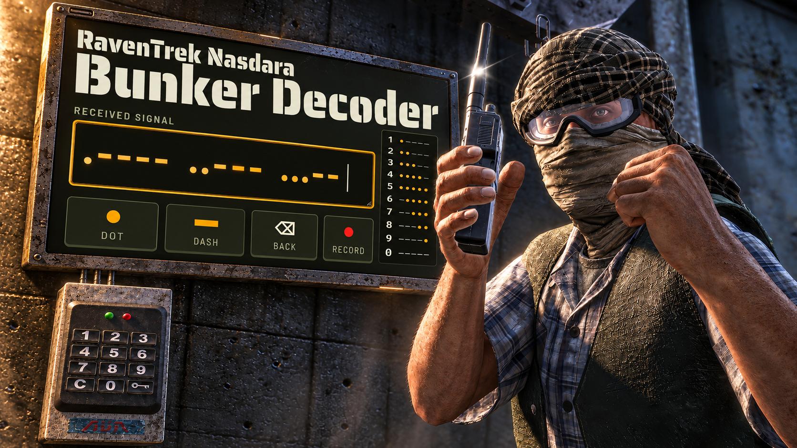

# RavenTrek Nasdara Bunker Decoder

Webový pomocník pro **DayZ na mapě Nasdara**, který převádí rádiové vysílání v morseovce na souřadnice a PINy bunkrů. Signál můžeš zadávat ručně, načíst ze zvukového souboru nebo zachytit mikrofonem. Aplikace je stále ve vývoji. Některé níže uvedené neduhy se podařilo ve V2 odstranit.



## Co aplikace umí

- **Dekódování číslic v morseovce** z teček a čárek nebo libovolných dvou zvolených znaků.
- **Automatické rozpoznání signálu**, včetně hledání začátku číslic a jednotlivých záznamů při připojení uprostřed vysílání.
- **Sledování tří opakujících se signálů** a doplňování údajů při dalších opakováních.
- **Porovnání souřadnic s 23 uloženými bunkry**, zobrazení možných shod a jejich polohy na mapě.
- **Odkazy na iZurvive** pro nalezené bunkry.
- **Zpracování nahrávek a živého zvuku**, detekci tónů a vizualizaci přijatého signálu.
- **Přehrávání se změnou rychlosti**, posunem v nahrávce a zvýrazněním právě přehrávaných symbolů.
- **Kopírování výsledků a export zvuku** do MP3, případně původního formátu.
- **Ovládání myší, klávesnicí i dotykovými tlačítky** na telefonu.

## Spuštění

1. Stáhni soubor **`nasdara-bunker-decoder.html`** z repozitáře.
2. Otevři ho ve webovém prohlížeči.
3. Zadej signál nebo načti herní nahrávku přes **Load audio file**.

Aplikace je v jednom HTML souboru. Pro lokální spuštění nepotřebuje instalaci, sestavení ani vlastní server. Dostupnost mikrofonu, zvukových formátů a trvalého ukládání závisí na použitém prohlížeči a jeho nastavení.

## Jak dekódovat vysílání

### Ruční zadávání

Do pole **Received signal** zapisuj tečky a čárky tak, jak je slyšíš. Můžeš použít také dvě jiné klávesy; v režimu **Auto** aplikace zkouší jejich přiřazení k tečce a čárce. Mezery a lomítka můžeš používat k oddělování skupin.

Na telefonu slouží k zadávání tlačítka **Dot**, **Dash** a **Back**. Pro vyzkoušení je k dispozici **Load example signal**.

### Zvukový soubor

Klikni na **Load audio file** a vyber záznam vysílání. Aplikace v něm vyhledá tóny a převede je na morseovku. Pro zobrazení výsledků z nahrávky zapni **Decode bunkers from the recording**.

Podporované formáty závisí na kodecích prohlížeče; aplikace nabízí výběr například MP3, WAV, M4A, OGG, WebM a MP4.

### Mikrofon

Klikni na **Record**, povol přístup k mikrofonu a zajisti, aby zvolený vstup slyšel herní vysílání. Aplikace průběžně zobrazuje detekované tóny a symboly. Kvůli známým chybám této verze si přečti část níže věnovanou mikrofonu.

## Jak číst výsledky

Každý záznam vysílání obsahuje deset číslic:

```text
XXX YYY PPPP
│   │   └── čtyřmístný PIN z vysílání
│   └────── řádek souřadnicové sítě, počítaný shora
└────────── sloupec souřadnicové sítě
```

Aplikace hledá odpovídající bunker podle prvních šesti číslic. PIN získává z dalších čtyř číslic přijatého signálu. Stav **Guessing**, **Likely** nebo **Locked** vyjadřuje odhad jistoty dekódování; při nejasném signálu zkontroluj zobrazené číslice a další opakování vysílání.

## Ukládání dat a připojení k internetu

Zpracování zvuku a dekódování probíhá v prohlížeči. Aplikace si v jeho úložišti uchovává zadaný signál, nastavení a poslední nahraný nebo načtený zvuk. Při dalším otevření se pokusí tato data obnovit.

- **Clear signal** slouží k vymazání ručně zadaného signálu.
- **Delete recording** slouží ke smazání uložené nahrávky.
- Zavření karty ani smazání samotného HTML souboru nepředstavuje vymazání uložených dat prohlížeče.
- Mikrofon může zachytit také okolní zvuky a rozhovory.

Samotné dekódování a vloženou mapu lze používat offline. Písma se načítají z **Google Fonts**, převod do MP3 podle potřeby načítá knihovnu **lamejs** z **jsDelivr** a odkazy na **iZurvive** potřebují internet. Pokud se MP3 převod nezdaří, export použije původní zvukový formát.

## Známá omezení prověřené verze

Následující chyby byly zjištěny v původním HTML kontrolovaném **19. 10. 2026**:

- **Souběžné spuštění mikrofonu:** rychlé opakované kliknutí na Record může spustit více záznamů. Stop pak nemusí ukončit všechny. Mikrofon může zůstat aktivní také při chybě během spouštění. Po použití zavři celou kartu aplikace a ověř indikátor mikrofonu v prohlížeči. Pro tuto verzi je vhodné použít předem pořízenou herní nahrávku.
- **Potvrzování Stop:** v běžném průběhu je nutné zastavení potvrdit druhým kliknutím do čtyř sekund. Skrytí panelu přes Hide záznam nezastavuje.
- **Hlášení o smazání:** při chybě úložiště může aplikace oznámit smazání nahrávky, i když se neprovedlo.
- **Externí MP3 knihovna:** načítaný skript nemá nastavenou kontrolu integrity obsahu pomocí SRI.

Přesnost výsledků ovlivňuje šum, překrývající se zvuky, délka záznamu a úplnost přijatého vysílání. Aplikace používá vestavěný seznam bunkrů; změny na konkrétním serveru mohou vyžadovat jeho aktualizaci. Dlouhé nahrávky a velké soubory mohou výrazně zatížit paměť a úložiště zařízení.

## Technologie

- HTML, CSS a JavaScript
- Web Audio API a MediaRecorder
- Web Worker pro analýzu zvuku
- Canvas pro vykreslení signálu a SVG pro značky na mapě
- localStorage a IndexedDB pro místní ukládání
- [lamejs](https://github.com/zhuker/lamejs) pro převod zvuku do MP3
- [iZurvive](https://www.izurvive.com/nasdaraSat/) pro navazující mapové odkazy

## Hlášení chyb

Při hlášení problému uveď prohlížeč, zařízení a postup, kterým se chyba projevila. U problémů s dekódováním přilož krátký přepis signálu nebo herní zvukový vzorek, pokud ho můžeš sdílet bez osobních údajů.
